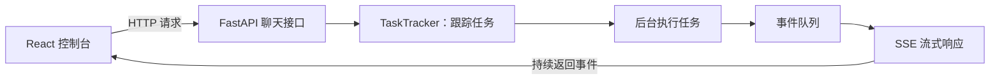

# 架构与数据流：已核查的聊天入口

范围：仅梳理已经阅读的入口与任务跟踪机制；不是完整系统架构、并发正确性审计或运行验收。

源码基线：`45c754ee694c3e27ced3d27f8971449be067f534`。链接固定到该提交，后续改动另记实验提交。

## 入口图

事件队列可以先理解为等待订阅者领取的事件列表；SSE 是服务器通过连接持续发送事件的响应方式。图中没有展开 Agent、模型、工具和存储内部过程，后续逐条追踪。

## 路由如何接起来

| 文件 | 已核查代码或符号 | 职责 |
| --- | --- | --- |
| [`_app.py`](https://github.com/wuseir/QwenPaw/blob/45c754ee694c3e27ced3d27f8971449be067f534/src/qwenpaw/app/_app.py) | `app.include_router(api_router, prefix="/api")` | 挂载公共 API 路由 |
| [`routers/__init__.py`](https://github.com/wuseir/QwenPaw/blob/45c754ee694c3e27ced3d27f8971449be067f534/src/qwenpaw/app/routers/__init__.py) | `router.include_router(console_router)` | 接入控制台路由 |
| [`routers/console.py`](https://github.com/wuseir/QwenPaw/blob/45c754ee694c3e27ced3d27f8971449be067f534/src/qwenpaw/app/routers/console.py) | `APIRouter(prefix="/console")`、`@router.post("/chat", ...)` | 定义聊天处理入口 |
| [`routers/console.py`](https://github.com/wuseir/QwenPaw/blob/45c754ee694c3e27ced3d27f8971449be067f534/src/qwenpaw/app/routers/console.py) | `post_console_chat` | 取得工作区、组织任务与流式返回 |
| [`task_tracker.py`](https://github.com/wuseir/QwenPaw/blob/45c754ee694c3e27ced3d27f8971449be067f534/src/qwenpaw/app/task_tracker.py) | `TaskTracker` | 跟踪任务与事件订阅 |

这是普通控制台路由的拼接练习。仓库另有按 Agent 作用域挂载的路由；真实前端使用哪个地址，需要启动后从浏览器 Network 核实，不能把普通入口直接当作所有请求的实际地址。

## 已读到的主要分支

`post_console_chat` 中：

1. 获取请求所对应的工作区和 Console channel；没有渠道时返回服务不可用错误。
2. 规范请求，确定会话，取得或创建聊天记录。
3. 重连请求尝试 `tracker.attach(chat.id)`；没有运行可挂接时返回立即结束的 SSE，客户端再读取持久历史。
4. 新请求通过 `tracker.attach_or_start(..., console_channel.stream_one, ...)` 组织执行。
5. 同一聊天已有任务且本次不是新运行时，接口返回冲突错误。
6. 响应生成器从 `tracker.stream_from_queue` 读取事件，以 `text/event-stream` 返回。
7. 生成器结束时关闭迭代器，确保相应订阅清理有机会执行。

这些是入口源码中的行为，不是已通过断网、并发或故障测试的结论。

## 断开连接不等于停止任务

源码注释明确写明：任务在断连后继续后台运行；停止通过单独的停止接口发起。

这使“任务执行”和“页面接收结果”成为两个不同生命周期。后续实验应比较：

- 页面关闭或网络中断；
- 使用停止按钮；
- 模型或任务超时。

研究问题：取消信号传到哪里？正在执行的工具是否响应？任务结束如何保存？重连拿到的是运行事件还是持久历史？这些尚未完成验证。

## 后续再补的图

真实启动和源码追踪后补全：

- 前端、Agent、工具、模型与存储的系统架构图；
- 一次工具调用的业务流程图；
- 请求、任务、模型、工具和持久化的时序图；
- 含错误、取消和恢复的真实状态流转图。

当前不凭经验填写这些图中的具体内部状态名。
